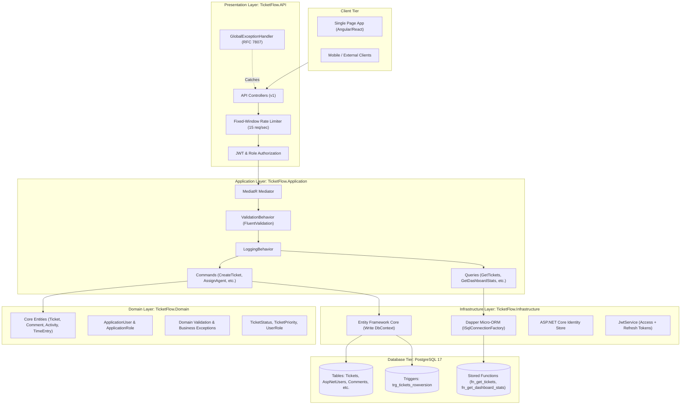
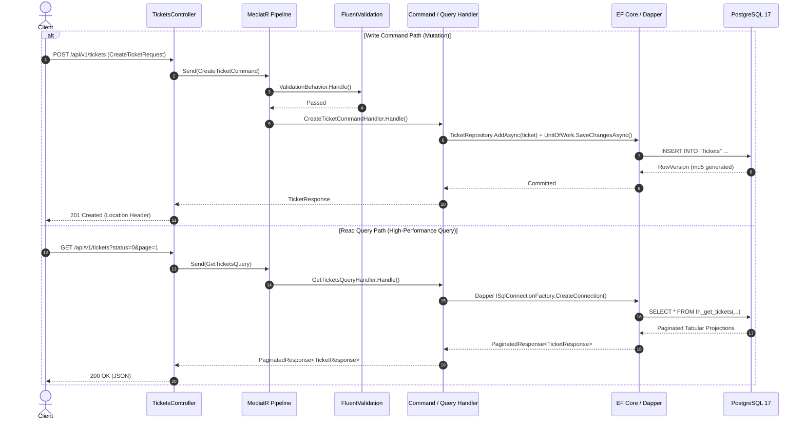
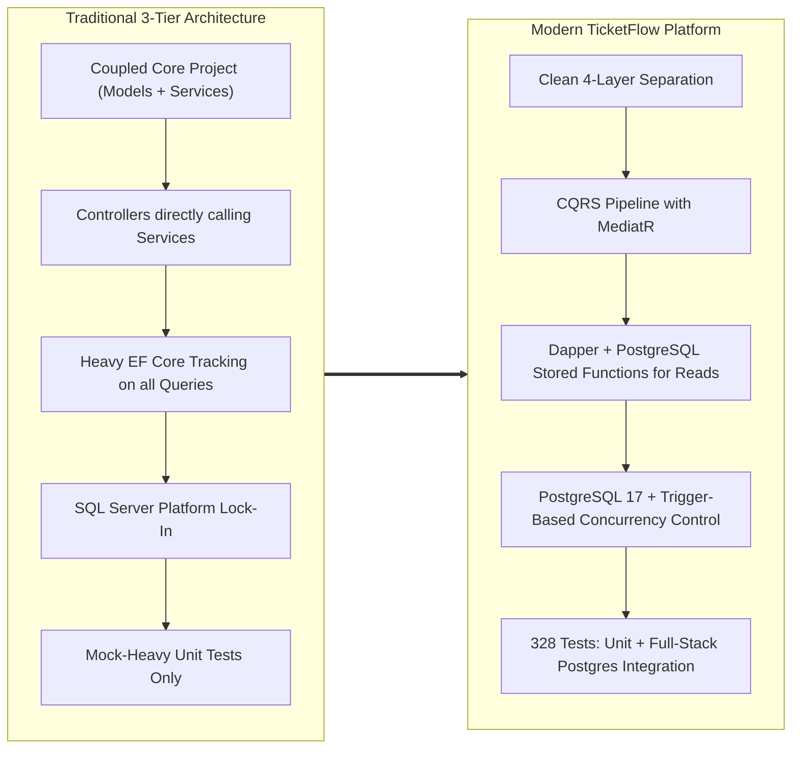
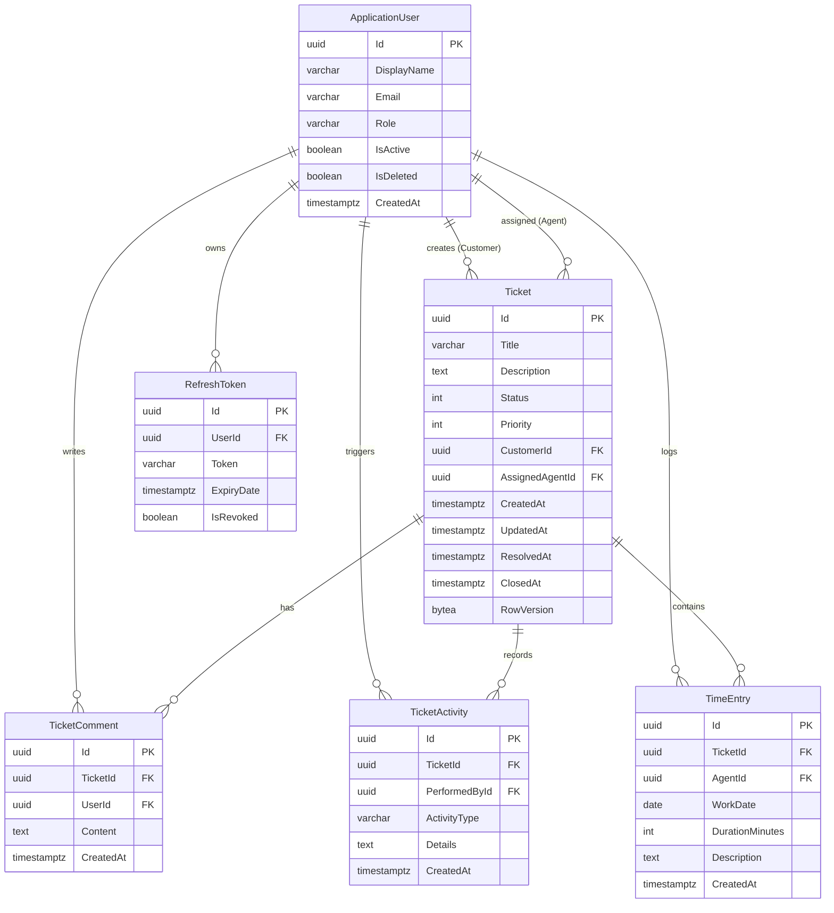
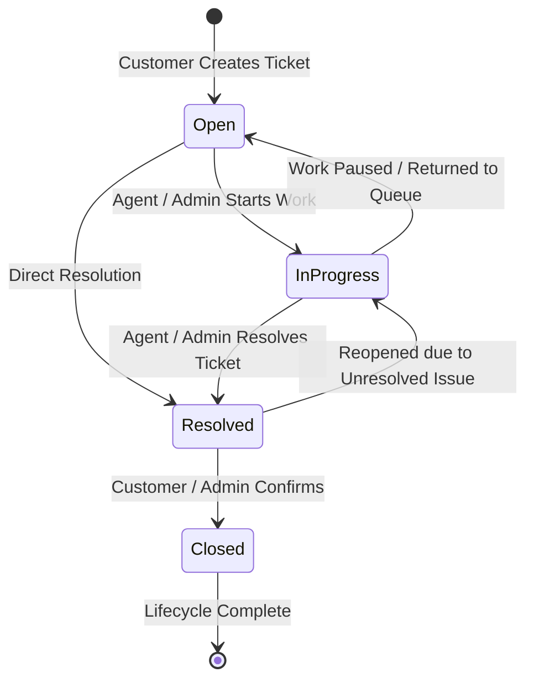
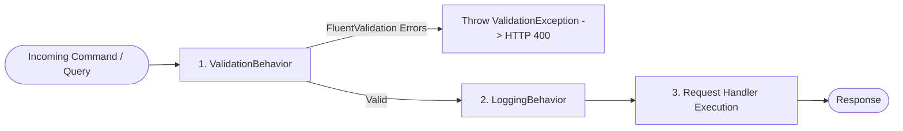

# TicketFlow — Enterprise Support Ticket Management Platform

[-512BD4?style=flat&logo=dotnet)](https://dotnet.microsoft.com/)
[](https://www.postgresql.org/)
[](https://learn.microsoft.com/en-us/dotnet/architecture/modern-web-apps-azure/common-web-application-architectures)
[](https://github.com/DapperLib/Dapper)
[](https://learn.microsoft.com/en-us/ef/core/)
[-brightgreen.svg)](https://github.com/Ibrahim-Hassan74/TicketFlow)
[](https://www.docker.com/)
[](LICENSE)

**TicketFlow** is a high-performance, enterprise-grade distributed customer support ticket management platform built on **ASP.NET Core 10 Web API**, **PostgreSQL 17**, and **Clean Architecture**. The platform is engineered for extreme reliability, concurrency safety, horizontal scalability, and strict security isolation.

It leverages a hybrid **CQRS (Command Query Responsibility Segregation)** pattern:
- **Write Path**: Modeled with **Entity Framework Core 10** and **Unit of Work / Repository**, enforcing rich domain invariants, optimistic concurrency control via PostgreSQL triggers, and ASP.NET Core Identity authentication.
- **Read Path**: Powered by **Dapper** executing native **PostgreSQL Stored Functions**, achieving sub-millisecond query performance, database-level aggregations, and zero ORM change-tracking overhead.

---

## Table of Contents

1. [Live Resources & Demos](#live-resources--demos)
2. [Architectural Overview](#architectural-overview)
3. [CQRS & Polyglot Persistence Design](#cqrs--polyglot-persistence-design)
4. [Architectural Migration Journey (Old vs. New)](#architectural-migration-journey-old-vs-new)
5. [Domain Model & Entity Lifecycle](#domain-model--entity-lifecycle)
6. [Security, Authorization & Data Isolation](#security-authorization--data-isolation)
7. [Cross-Cutting Concerns & Pipeline Behaviors](#cross-cutting-concerns--pipeline-behaviors)
8. [API Endpoints Reference](#api-endpoints-reference)
9. [Automated Testing Strategy (328/328 Green)](#automated-testing-strategy-328328-green)
10. [Observability & Structured Telemetry](#observability--structured-telemetry)
11. [Database Setup & Automated Docker Orchestration](#database-setup--automated-docker-orchestration)
12. [Local Development & Quickstart](#local-development--quickstart)
13. [Default Seed Credentials](#default-seed-credentials)
14. [Changelog](#changelog)
15. [License](#license)

---

## Live Resources & Demos

- **Live API Endpoint**: [https://support-ticket.runasp.net/api/v1](https://support-ticket.runasp.net/api/v1)
- **Interactive Swagger / OpenAPI UI**: [https://support-ticket.runasp.net/swagger/index.html](https://support-ticket.runasp.net/swagger/index.html)
- **API Testing Collection (`.http`)**: [`TicketFlow.API.http`](TicketFlow.API/TicketFlow.API.http) (Full request suite for Visual Studio & VS Code REST Client)
- **Live Frontend Application**: [https://ticket--hub.web.app](https://ticket--hub.web.app)
- **Frontend Source Repository**: [Ibrahim-Hassan74/TicketHub](https://github.com/Ibrahim-Hassan74/TicketHub)
- **Backend Source Repository**: [Ibrahim-Hassan74/TicketFlow](https://github.com/Ibrahim-Hassan74/TicketFlow)

---

## Architectural Overview

TicketFlow is structured around the principles of **Clean Architecture** (Ports & Adapters / Onion Architecture) and **CQRS**. Dependencies flow strictly inwards toward the core domain:

```
[ Presentation (API) ] ──> [ Application ] ──> [ Domain ]
          │                         │
          └───> [ Infrastructure ] ─┘
```



### Solution Project Breakdown

| Project | Target Framework | Purpose & Responsibilities |
| :--- | :--- | :--- |
| **`TicketFlow.Domain`** | `.NET 10` | Enterprise entities, enums, domain exceptions, identity entities, and core repository contracts (`IUnitOfWork`, `ITicketsRepository`, `IGenericRepository`, `ITicketActivityRepository`, `ITicketCommentRepository`, `ITimeEntryRepository`). Zero external NuGet dependencies. |
| **`TicketFlow.Application`** | `.NET 10` | Application business rules, MediatR Commands/Queries, FluentValidation validators, pipeline behaviors, and application service interfaces (`ISqlConnectionFactory`, `IJwtService`, `ICurrentUserService`, `IDashboardRepository`, `IUserRepository`, `ITicketAuthorizationService`). |
| **`TicketFlow.Infrastructure`** | `.NET 10` | EF Core `ApplicationDbContext`, Npgsql provider, entity mappings, migrations, Dapper query executions, ASP.NET Core Identity store, JWT service, seeders. |
| **`TicketFlow.API`** | `.NET 10` | Web API endpoints, API versioning (`v1`), Swagger generation, IP rate limiting, Serilog logging, `IExceptionHandler` RFC 7807 problem details. |
| **`TicketFlow.Application.Tests`** | `.NET 10` | Unit test suite (272 tests) verifying all command handlers, query handlers, domain logic, and validation behaviors. |
| **`TicketFlow.API.Tests`** | `.NET 10` | Unit test suite (43 tests) testing controller actions, exception mapping, rate limiting, and HTTP contracts. |
| **`TicketFlow.IntegrationTests`** | `.NET 10` | Full E2E integration test suite (13 tests) executing against a live PostgreSQL database via `CustomWebApplicationFactory`. |

---

## CQRS & Polyglot Persistence Design

To maximize performance, data integrity, and maintainability, TicketFlow bifurcates reads and writes into dedicated, specialized pipelines.



### 1. The Write Path (Commands)
- **Mediated Mutators**: Handlers mutate state only through Domain Entities and aggregate boundaries.
- **Transactional Consistency**: Changes are tracked by **Entity Framework Core 10** (`Npgsql.EntityFrameworkCore.PostgreSQL`) and committed atomically using `IUnitOfWork.SaveChangesAsync()`.
- **Automatic Audit Trail**: State transitions (status updates, agent assignments) automatically generate and persist immutable `TicketActivity` entries within the same database transaction.
- **Optimistic Concurrency Control**:
  - PostgreSQL does not natively provide a SQL Server-style auto-updating `rowversion` column.
  - TicketFlow implements this via a database trigger `trg_tickets_rowversion` running `update_ticket_rowversion()`, which recalculates `NEW."RowVersion" = md5(random()::text)::bytea` on every row modification.
  - EF Core detects version discrepancies and throws `DbUpdateConcurrencyException`, gracefully handled and translated to **HTTP 409 Conflict**.

### 2. The Read Path (Queries)
- **Zero ORM Overhead**: Read queries bypass EF Core change trackers entirely.
- **Direct Dapper Projections**: Reads run through lightweight **Dapper** connections mapped directly to clean projection DTOs.
- **PostgreSQL Stored Functions**: Complex joins, JSON array aggregations, and filtered pagination are encapsulated inside optimized PL/pgSQL stored functions.

#### PostgreSQL Stored Functions Catalog

| Function Name | Description | Key Optimizations |
| :--- | :--- | :--- |
| **`fn_get_dashboard_stats()`** | Aggregates system metrics (total, open, in-progress, resolved, closed, critical open, avg resolution time). | Single-pass conditional aggregation via `COUNT(*) FILTER (WHERE ...)`. |
| **`fn_get_agent_workload()`** | Returns active tickets and aggregate time spent per agent. | `GROUP BY` with `COALESCE(SUM(te."DurationMinutes"), 0)` and deleted user filtering. |
| **`fn_get_ticket_trends(p_days)`** | Returns daily ticket creation and resolution trends over a variable rolling period. | Continuous date range generation using `generate_series(...)` to prevent missing day gaps. |
| **`fn_get_tickets(...)`** | High-performance multi-criteria search, filtering, dynamic sorting, and pagination. | Dynamic SQL with parameterized sanitized inputs, role-based customer filtering, and `COUNT(*) OVER()`. |
| **`fn_get_ticket_by_id(...)`** | Fetches single ticket with embedded JSON arrays of comments, activities, and time entries. | `json_agg(...)` subqueries providing an entire ticket aggregate in a single round-trip. |
| **`fn_get_ticket_comments(...)`** | Retrieves chronological discussion thread for a ticket. | Filtered by customer ownership if caller is in Customer role. |
| **`fn_get_ticket_activities(...)`** | Retrieves immutable audit trail for a ticket. | Ordered descending by `CreatedAt`. |
| **`fn_get_ticket_time_entries(...)`** | Retrieves logged time entries with calculated total duration. | Restricted to Support Agents and Administrators. |
| **`fn_get_users(...)`** | Paginated system user list with search, active filtering, and role joins. | Fast ILIKE search on email and display name. |
| **`fn_get_user_by_id(...)`** | Retrieves user profile with assigned role name. | Single row join on `AspNetUserRoles` and `AspNetRoles`. |
| **`fn_get_agents(...)`** | Lists all active support agents for ticket assignment. | Filtered join on role `SupportAgent`. |

---

## Architectural Migration Journey (Old vs. New)

TicketFlow underwent a complete ground-up re-architecture to transform from a traditional 3-tier layered architecture into a modern, enterprise-ready Clean Architecture + CQRS platform:



### Transformation Breakdown

| Dimension | Traditional 3-Tier Architecture | Modern TicketFlow (Current) |
| :--- | :--- | :--- |
| **Layering** | Traditional 3-tier (`API`, `Core`, `Infrastructure`). Domain entities, DTOs, and procedural services bundled in a single `Core` project. | **Clean 4-Layer Architecture** (`Domain`, `Application`, `Infrastructure`, `API`) with strict inward dependency rule. |
| **Execution Pattern** | Procedural services calling EF Core methods for both queries and updates. | **CQRS via MediatR**. Strict decoupling of Commands (mutations) and Queries (reads). |
| **Read Performance** | EF Core `DbContext` tracking across all operations; expensive joins in memory. | **Dapper Micro-ORM** invoking optimized PostgreSQL stored functions with zero tracking overhead. |
| **Database Engine** | SQL Server (local development dependence). | **PostgreSQL 17 (Npgsql)** with native types (`UUID`, `TIMESTAMPTZ`, `BYTEA`). |
| **Optimistic Concurrency** | Unhandled concurrency collisions; risk of silent overwrites. | **PostgreSQL `BEFORE UPDATE` trigger** (`trg_tickets_rowversion`) + EF Concurrency Token + HTTP 409 Conflict. |
| **Cross-Cutting Pipeline** | Ad-hoc service checks and manual controller validations. | **MediatR Pipeline Behaviors** (`ValidationBehavior` with FluentValidation, `LoggingBehavior`). |
| **Exception Handling** | Custom middleware with inconsistent JSON shapes. | **ASP.NET Core `IExceptionHandler`** producing standardized **RFC 7807 Problem Details**. |
| **Logging & Telemetry** | Basic console logging. | **Serilog** with structured context, daily rolling log files, and **Seq sink** integration. |
| **Testing Coverage** | Legacy controller/service tests with extensive mocking and low coverage. | **328 Automated Tests**: 272 Application Unit Tests, 43 API Unit Tests, and 13 full-stack PostgreSQL Integration Tests. |
| **Deployment** | Local installation dependency. | **Docker & Docker Compose** multi-container setup with automated schema & stored function initialization scripts. |

---

## Domain Model & Entity Lifecycle

### Entity Relationships (ERD)



### Ticket State Machine

TicketFlow enforces deterministic status transitions. Invalid state jumps are actively blocked by the Domain validation layer:



#### Transition Rules Matrix

| From Status | Allowed Target Statuses | Authorized Roles | Mandatory System Side Effects |
| :--- | :--- | :--- | :--- |
| **`Open`** | `InProgress`, `Resolved` | `SupportAgent`, `Admin` | Sets `UpdatedAt`, logs `TicketActivity`. |
| **`InProgress`** | `Resolved`, `Open` | `SupportAgent`, `Admin` | Sets `ResolvedAt` (if resolved), logs `TicketActivity`. |
| **`Resolved`** | `Closed`, `InProgress` | `Customer` (own ticket), `Admin` | Sets `ClosedAt` (if closed), logs `TicketActivity`. |
| **`Closed`** | *Terminal state* | — | Modifications locked. |

---

## Security, Authorization & Data Isolation

### 1. Authentication & Token Management
- **JWT (JSON Web Tokens)**: Cryptographically signed via HMAC-SHA256 with 30-minute default expiration.
- **Refresh Token Rotation**: Secure, cryptographically random refresh tokens stored in PostgreSQL. Upon token refresh, the old token is revoked and a new pair is issued, preventing replay attacks.
- **Zero-Trust Token Validation**: The API validates `Issuer`, `Audience`, `Lifetime`, `SigningKey`, and sets `ClockSkew = TimeSpan.Zero`.

### 2. Role-Based Access Control (RBAC)
The system establishes three distinct authorization tiers:
- **`Admin`**: Full operational control (user administration, system dashboard analytics, agent assignments, ticket priority and status updates).
- **`SupportAgent`**: Can view assigned/open tickets, update ticket statuses, log work time entries, and add internal/public comments.
- **`Customer`**: Can register accounts, create tickets, view own tickets, add comments, and close resolved tickets.

### 3. Customer Horizontal Data Isolation (IDOR Defense)
To prevent Insecure Direct Object Reference (IDOR) vulnerabilities:
- Every query and command extracts the authenticated caller's identity via `ICurrentUserService`.
- If the caller possesses the `Customer` role, all read and write queries automatically append a mandatory predicate:
  ```sql
  WHERE "CustomerId" = @UserId
  ```
- Customers cannot read, comment on, or manipulate tickets belonging to other customers; attempts immediately result in **HTTP 404 Not Found** or **HTTP 403 Forbidden**.

### 4. Rate Limiting Protection
Built-in ASP.NET Core Partitioned Rate Limiter:
- **Algorithm**: Fixed-Window Rate Limiting.
- **Threshold**: **15 requests per second** partitioned by client IP address.
- **Rejection Policy**: HTTP 429 Too Many Requests formatted as an RFC 7807 Problem Details payload.

---

## Cross-Cutting Concerns & Pipeline Behaviors

TicketFlow integrates MediatR pipeline behaviors to enforce consistency across every request without boilerplate:



1. **`ValidationBehavior<TRequest, TResponse>`**:
   Automatically discovers and executes all registered `IValidator<TRequest>` FluentValidation rules before the handler executes. If validation fails, it throws a `ValidationException` which the global exception handler translates into HTTP 400 with field-specific errors.
2. **`LoggingBehavior<TRequest, TResponse>`**:
   Captures structured diagnostics for every request, logging execution duration, payload parameters, and alerting if a request exceeds performance thresholds.
3. **`GlobalExceptionHandler` (`IExceptionHandler`)**:
   Centralized RFC 7807 Problem Details translator mapping:
   - `ValidationException` &rarr; **400 Bad Request**
   - `IdentityOperationException` &rarr; **400 Bad Request**
   - `DomainValidationException` / `BadRequestException` &rarr; **400 Bad Request**
   - `UnauthorizedException` / `InvalidCredentialsException` &rarr; **401 Unauthorized**
   - `ForbiddenException` / `AccountDeactivatedException` &rarr; **403 Forbidden**
   - `NotFoundException` &rarr; **404 Not Found**
   - `ConflictException` / `EmailAlreadyExistsException` &rarr; **409 Conflict**
   - `DbUpdateConcurrencyException` &rarr; **409 Conflict**
   - `AccountLockedException` &rarr; **423 Locked**
   - Unhandled exceptions &rarr; **500 Internal Server Error** (with internal details suppressed from client).

---

## API Endpoints Reference

All endpoints are versioned under `/api/v1/` and enforce strict authentication policies.

### Authentication & Account (`/api/v1/Account`)

| Method | Endpoint | Access | Description |
| :--- | :--- | :--- | :--- |
| `POST` | `/api/v1/account/register` | Anonymous | Register a new Customer account. |
| `POST` | `/api/v1/account/login` | Anonymous | Authenticate with credentials and receive JWT + Refresh Token. |
| `POST` | `/api/v1/account/generate-new-jwt-token` | Anonymous | Rotate refresh token and obtain a new JWT access token. |
| `POST` | `/api/v1/account/logout` | Authenticated | Revoke refresh tokens and invalidate current session. |
| `GET` | `/api/v1/account/me` | Authenticated | Retrieve current user's profile and active roles. |

### Tickets (`/api/v1/Tickets`)

| Method | Endpoint | Access | Description |
| :--- | :--- | :--- | :--- |
| `GET` | `/api/v1/tickets` | Authenticated | Paginated, filtered, and sorted ticket search (customer-isolated). |
| `GET` | `/api/v1/tickets/{id}` | Authenticated | Get ticket details including comments, activities, and time logs. |
| `POST` | `/api/v1/tickets` | `Customer` | Create a new support ticket. |
| `PUT` | `/api/v1/tickets/{id}` | `Admin` | Update ticket title and description. |
| `PATCH`| `/api/v1/tickets/{id}/status` | Authenticated | Advance ticket through allowed lifecycle transitions. |
| `PATCH`| `/api/v1/tickets/{id}/priority` | `Admin` | Update ticket priority (`Low`, `Medium`, `High`, `Critical`). |
| `PATCH`| `/api/v1/tickets/{id}/assign` | `Admin` | Assign ticket to an active support agent. |

### Comments & Audit Activities

| Method | Endpoint | Access | Description |
| :--- | :--- | :--- | :--- |
| `GET` | `/api/v1/tickets/{id}/comments` | Authenticated | List all discussion comments for a ticket. |
| `POST` | `/api/v1/tickets/{id}/comments` | Authenticated | Add a comment to a ticket thread. |
| `GET` | `/api/v1/tickets/{id}/activities` | Authenticated | Retrieve full immutable timeline of ticket modifications. |

### Time Entries (`/api/v1/tickets/{id}/time-entries`)

| Method | Endpoint | Access | Description |
| :--- | :--- | :--- | :--- |
| `GET` | `/api/v1/tickets/{id}/time-entries` | `Agent`, `Admin` | Get logged work time entries and total accumulated duration. |
| `POST` | `/api/v1/tickets/{id}/time-entries` | `SupportAgent` | Log work time against an assigned ticket. |

### Dashboard & Analytics (`/api/v1/Dashboard`)

| Method | Endpoint | Access | Description |
| :--- | :--- | :--- | :--- |
| `GET` | `/api/v1/dashboard/stats` | `Admin` | Real-time counts, critical open tickets, and avg resolution hours. |
| `GET` | `/api/v1/dashboard/agent-workload` | `Admin` | Workload distribution and total logged time per agent. |
| `GET` | `/api/v1/dashboard/ticket-trends` | `Admin` | Daily ticket creation and resolution volume over time. |

### User Management (`/api/v1/Users`)

| Method | Endpoint | Access | Description |
| :--- | :--- | :--- | :--- |
| `GET` | `/api/v1/users` | `Admin` | Paginated user directory with search and status filters. |
| `GET` | `/api/v1/users/{id}` | `Admin` | Get detailed user information by ID. |
| `POST` | `/api/v1/users` | `Admin` | Create an internal user account (`Admin` or `SupportAgent`). |
| `PUT` | `/api/v1/users/{id}` | `Admin` | Update user display name or active status. |
| `GET` | `/api/v1/users/agents` | `Admin` | Retrieve active agents available for ticket assignment. |

### Interactive Testing with REST Client (`TicketFlow.API.http`)

The repository includes a ready-to-run HTTP request collection located at [`TicketFlow.API/TicketFlow.API.http`](TicketFlow.API/TicketFlow.API.http).
- **Environment Support**: Works out-of-the-box in **Visual Studio 2022+** and **VS Code** (using the *REST Client* extension).
- **Automated Token Chaining**: Uses named login requests (e.g., `# @name adminLogin`) to automatically capture JWT access tokens and inject them into subsequent authenticated requests (`{{adminLogin.response.body.token}}`).
- **Complete Endpoint Coverage**: Contains pre-built request bodies, headers, and query parameters for every endpoint in the platform (Authentication, Tickets, Comments, Activities, Time Entries, Dashboard metrics, and User management).

---

## Automated Testing Strategy (328/328 Green)

TicketFlow maintains a rigorous **100% passing test suite** with 328 automated tests covering all layers.

```
       ▲
      / \     [ 13 E2E Integration Tests ]  (PostgreSQL, Auth, Dapper, IDOR, Lifecycle)
     /---\
    /     \   [ 43 API Unit Tests ]          (Controllers, Exception Handler, Rate Limiting)
   /-------\
  /         \ [ 272 Application Unit Tests ] (CQRS Handlers, Domain Rules, FluentValidation)
  -----------
```

### Test Suite Execution Summary

```bash
dotnet test --no-restore
```

```text
Passed! - Failed: 0, Passed: 272, Skipped: 0 - TicketFlow.Application.Tests.dll (net10.0)
Passed! - Failed: 0, Passed:  43, Skipped: 0 - TicketFlow.API.Tests.dll (net10.0)
Passed! - Failed: 0, Passed:  13, Skipped: 0 - TicketFlow.IntegrationTests.dll (net10.0)
Total: 328 passed, 0 failed, 0 skipped
```

### Test Categories

1. **Application Unit Tests (`TicketFlow.Application.Tests` - 272 tests)**:
   - Exhaustive testing of every MediatR Command and Query Handler.
   - Comprehensive FluentValidation rule assertions.
   - Domain invariants (ticket lifecycle state transitions, unauthorized assignments).
   - Mocking repository and unit-of-work dependencies using **Moq** and **FluentAssertions**.

2. **API Unit Tests (`TicketFlow.API.Tests` - 43 tests)**:
   - Controller action responses and status code verification.
   - `GlobalExceptionHandler` mapping: 400, 401, 403, 404, 409 (Concurrency), 423, and 500 error scenarios.
   - IP rate limiter functionality and rejection behavior.

3. **PostgreSQL Integration Tests (`TicketFlow.IntegrationTests` - 13 tests)**:
   - Uses `CustomWebApplicationFactory<Program>` pointing to the `"Testing"` environment.
   - Tests execute against a **real PostgreSQL database instance**.
   - **`AccountIntegrationTests`**: User registration, login flow, JWT claims, and identity token lifecycles.
   - **`DashboardIntegrationTests`**: Direct execution and verification of Dapper read stored functions (`fn_get_dashboard_stats`, `fn_get_agent_workload`, `fn_get_ticket_trends`).
   - **`TicketLifecycleIntegrationTests`**: Full end-to-end multi-role lifecycle flow (Customer creates &rarr; Admin assigns agent &rarr; Agent accepts & updates status to InProgress &rarr; Agent logs time &rarr; Agent resolves &rarr; Customer closes).
   - **`TicketSecurityIntegrationTests`**:
     - Customer IDOR isolation: Customer A is prohibited from reading or mutating Customer B's tickets.
     - Role boundary enforcement: Customers cannot access administrative endpoints or assign tickets.
     - Concurrency conflict simulation: Verifies HTTP 409 response when concurrent updates collide.

---

## Observability & Structured Telemetry

TicketFlow uses **Serilog** for enterprise-grade structured logging:
- **Console Sink**: Colorized formatted output for rapid local debugging.
- **File Sink**: Daily rolling log files stored under `Logs/log-.txt` with automated retention.
- **Seq Sink**: Real-time structured telemetry ingestion via Seq (configurable in `appsettings.json` or environment variables).
- **Enrichers**: Enriched with `MachineName`, `ThreadId`, `EnvironmentName`, and request-scoped correlation properties.

```json
"Serilog": {
  "Using": [ "Serilog.Sinks.Console", "Serilog.Sinks.File", "Serilog.Sinks.Seq" ],
  "MinimumLevel": {
    "Default": "Information",
    "Override": {
      "Microsoft": "Warning",
      "Microsoft.Hosting.Lifetime": "Information"
    }
  },
  "WriteTo": [
    { "Name": "Console" },
    {
      "Name": "File",
      "Args": {
        "path": "Logs/log-.txt",
        "rollingInterval": "Day",
        "retainedFileCountLimit": 30
      }
    },
    {
      "Name": "Seq",
      "Args": {
        "serverUrl": "http://localhost:5341"
      }
    }
  ]
}
```

---

## Database Setup & Automated Docker Orchestration

The project includes a multi-container Docker configuration orchestrating the ASP.NET Core 10 Web API and a PostgreSQL 17 engine.

### Automated Initialization Scripts
When the PostgreSQL container starts for the first time, scripts in `TicketFlow.Infrastructure/Persistence/Scripts/` mounted to `/docker-entrypoint-initdb.d:ro` execute automatically in alphabetical order:
1. **`000_FullPostgreSQLInit.sql`**: Creates tables, sequences, identity schemas, triggers, and the EF Core `__EFMigrationsHistory` table.
2. **`001_CreateReadStoredFunctions.sql`**: Creates all idempotent Dapper PL/pgSQL read stored functions.

### Running with Docker Compose

1. Copy the environment template:
   ```bash
   cp .env.example .env
   ```
2. Adjust environment variables in `.env` as desired:
   ```env
   POSTGRES_DB=ticketflow_db
   POSTGRES_USER=postgres
   POSTGRES_PASSWORD=YourStrongPassword123!
   POSTGRES_PORT=5432
   API_HTTP_PORT=5000
   API_HTTPS_PORT=5001
   JWT_KEY=YourSuperSecretKeyWithAtLeast32Characters!
   JWT_ISSUER=https://support-ticket.api
   ALLOWED_ORIGINS=https://ticket--hub.web.app,http://localhost:4200
   ```
3. Build and run the containers:
   ```bash
   docker compose up -d --build
   ```
4. Verify container status:
   ```bash
   docker compose ps
   ```
   The API will wait for PostgreSQL to become healthy before launching, and Swagger will be accessible at:
   `http://localhost:5000/swagger/index.html`

---

## Local Development & Quickstart

### Prerequisites
- [.NET 10 SDK (Preview)](https://dotnet.microsoft.com/)
- [PostgreSQL 16 or 17](https://www.postgresql.org/download/)
- [Docker Desktop](https://www.docker.com/products/docker-desktop/) (optional, for containerized run)

### Step-by-Step Setup

1. **Clone the repository**:
   ```bash
   git clone https://github.com/Ibrahim-Hassan74/TicketFlow.git
   cd TicketFlow
   ```

2. **Configure Local Settings**:
   Create or update `TicketFlow.API/appsettings.Development.json` with your local PostgreSQL credentials:
   ```json
   {
     "ConnectionStrings": {
       "DefaultConnection": "Host=localhost;Port=5432;Database=ticketflow_dev;Username=postgres;Password=YourPassword;"
     },
     "Jwt": {
       "Issuer": "https://support-ticket.api",
       "Audiences": [ "https://localhost:4200", "postman-client" ],
       "EXPIRATION_MINUTES": 30,
       "Key": "YourSuperSecretKeyWithAtLeast32Characters!"
     },
     "AllowedOrigins": [
       "https://ticket--hub.web.app",
       "http://localhost:4200"
     ]
   }
   ```

3. **Apply Database Migrations & Stored Functions**:
   ```bash
   dotnet ef database update --project TicketFlow.Infrastructure --startup-project TicketFlow.API
   ```
   *Note: To apply the Dapper read stored functions, execute `TicketFlow.Infrastructure/Persistence/Scripts/001_CreateReadStoredFunctions.sql` in your PostgreSQL database.*

4. **Run the API**:
   ```bash
   dotnet run --project TicketFlow.API
   ```

5. **Execute Automated Tests**:
   ```bash
   dotnet test
   ```

6. **Test API via REST Client**:
   Open [`TicketFlow.API/TicketFlow.API.http`](TicketFlow.API/TicketFlow.API.http) in Visual Studio or VS Code and click **Send Request** to test authentication, ticket lifecycle, and dashboard endpoints directly.

---

## Default Seed Credentials

During initialization, the database automatically provisions standard development and testing accounts:

| Role | Email Address | Password | Permissions Scope |
| :--- | :--- | :--- | :--- |
| **`Admin`** | `admin1@example.com` | `Aa1234567` | System analytics, user administration, assignments, full ticket management. |
| **`SupportAgent`** | `agent1@example.com` | `Aa1234567` | Assigned ticket handling, status updates, work time logging, commenting. |
| **`Customer`** | `customer1@example.com` | `Aa1234567` | Ticket creation, isolated ticket viewing, commenting, confirmation closing. |

---

## Changelog

Detailed release notes and architectural milestones are documented in [CHANGELOG.md](CHANGELOG.md).

---

## License

This project is licensed under the [MIT License](LICENSE).
